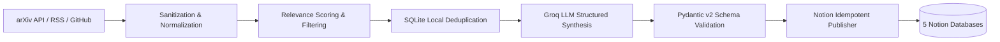

# AI/ML Notion Researcher

Production-ready, autonomous Python application that continuously monitors AI/ML research developments, synthesizes comprehensive educational notes via Groq LLM inference, and publishes structured notes to Notion.

---

## 1. System Architecture



### The 9-Stage Pipeline
1. **Multi-Source Collection**: Queries arXiv (`cs.AI`, `cs.LG`, `cs.CL`), AI lab engineering blogs (HuggingFace, OpenAI, DeepMind, BAIR), and GitHub releases (`vLLM`, `transformers`, etc.).
2. **HTML & Prompt-Injection Defense**: Strips raw HTML and neutralizes adversarial prompt injection patterns (`ignore previous instructions`, `<system>`, etc.).
3. **Relevance Scoring**: Heuristically scores technical novelty and density (filtering noise below threshold `0.40`, overridable via `--min-score`).
4. **Dual-Layer Deduplication**:
   - *Layer 1 (Local)*: SQLite database records processed URLs and hashes.
   - *Layer 2 (Remote)*: Notion API query by `Canonical ID` ensures duplicate prevention across ephemeral CI runners.
5. **LLM Synthesis**: Prompts Groq (`llama-3.3-70b-versatile`) in JSON mode to synthesize 11-part educational notes.
6. **Schema Validation**: Guarantees output conforms to strict Pydantic models.
7. **Adaptive Notion Block Building**: Handles Notion's 2,000-character rich text limit and 100-block per request chunking.
8. **Idempotent Publication**: Creates formatted pages in the appropriate Notion database.
9. **Execution Logging**: Reports runtime metrics and errors with zero-crash isolation.

---

## 2. The 5 Notion Databases

| Database | Purpose | Key Page Properties |
| :--- | :--- | :--- |
| **Daily Briefings** | High-level developments, summaries, and implications | `Name` (title), `Canonical ID` (text), `Summary` (text), `Date` (date), `URL` (url) |
| **Concept Library** | Deep dives into core ML concepts and architectures | `Name` (title), `Canonical ID` (text), `Tags` (multi-select), `Summary` (text) |
| **Research Papers** | Problem, proposed method, benchmark results, limits | `Name` (title), `Canonical ID` (text), `URL` (url), `Date` (date) |
| **Tools & Frameworks** | Library explanations, where they fit, code examples | `Name` (title), `Canonical ID` (text), `Tags` (multi-select), `URL` (url) |
| **Weekly Reviews** | Cross-synthesis of the week's concepts and lessons | `Name` (title), `Date` (date) |

---

## 3. Note Quality (11 Key Sections)

Every generated note contains:
1. **Title and Executive Summary** (callout block)
2. **Layman's Explanation** (intuitive analogies)
3. **Technical Explanation & Theory** (mechanisms & math)
4. **Step-by-Step Architecture Flow** (numbered steps)
5. **Architecture Diagram** (Mermaid code blocks)
6. **Real-World Applications** (concrete deployment cases)
7. **Ecosystem & Technologies Interaction** (how it fits with vLLM, PyTorch, etc.)
8. **Advantages, Limitations, and Trade-Offs** (explicit trade-offs)
9. **Practical Implementation Exercise** (hands-on coding challenge)
10. **Technical Interview Preparation** (3 high-yield questions & takeaways)
11. **Original Research Links** (direct citations)

---

## 4. Local Setup & Verification

### 1. Configuration
Copy `.env.example` to `.env` and fill in your credentials:
```bash
cp .env.example .env
```

### 2. Verify Notion Connectivity (Read-Only)
Run the verification script to inspect database schemas without writing any pages:
```bash
python scripts/verify_notion_connection.py
```

### 3. Run Pipeline Locally

**Dry-Run Mode (Safe simulation, zero Notion writes):**
```bash
python -m ai_ml_notion_researcher.main --dry-run
```

**Live Mode (Publishes directly to Notion):**
```bash
python -m ai_ml_notion_researcher.main --live
```

**Custom Research Topic (e.g. robotics, speech, quantum_ml):**
```bash
python -m ai_ml_notion_researcher.main --live --topic "robotics" --min-score 0.35
```

**Direct Custom Note Generation (On-demand paper or URL):**
```bash
python -m ai_ml_notion_researcher.main --live --custom-url "https://arxiv.org/abs/2303.08774" --custom-title "GPT-4 Technical Report"
```

**Weekly Synthesis Mode:**
```bash
python -m ai_ml_notion_researcher.main --weekly --dry-run
```

### 4. Run Test Suite
```bash
pytest
python -m ruff check .
```

---

## 5. GitHub Actions Automation

### Schedules
- **Daily Research**: Runs every day at **7:00 AM IST** (`01:30 UTC`) via [`.github/workflows/daily_research.yml`](file:///.github/workflows/daily_research.yml).
- **Weekly Review**: Runs every Sunday at **7:00 AM IST** (`01:30 UTC`) via [`.github/workflows/weekly_review.yml`](file:///.github/workflows/weekly_review.yml).
- **CI**: Automated testing and linting across Python 3.11 and 3.12 on every push/PR via [`.github/workflows/ci.yml`](file:///.github/workflows/ci.yml).

### GitHub Secrets Configuration
In your GitHub repository, navigate to **Settings** $\rightarrow$ **Secrets and variables** $\rightarrow$ **Actions** and add:

| Secret Name | Description |
| :--- | :--- |
| `GROQ_API_KEY` | Your Groq API key from [console.groq.com](https://console.groq.com/keys) |
| `NOTION_API_KEY` | Notion Internal Integration Secret from [notion.so/my-integrations](https://www.notion.so/my-integrations) |
| `NOTION_DATABASE_ID_DAILY_BRIEFINGS` | 32-character hex ID for Daily Briefings database |
| `NOTION_DATABASE_ID_CONCEPT_LIBRARY` | 32-character hex ID for Concept Library database |
| `NOTION_DATABASE_ID_RESEARCH_PAPERS` | 32-character hex ID for Research Papers database |
| `NOTION_DATABASE_ID_TOOLS_FRAMEWORKS` | 32-character hex ID for Tools and Frameworks database |
| `NOTION_DATABASE_ID_WEEKLY_REVIEWS` | 32-character hex ID for Weekly Reviews database |
| `GH_TOKEN` *(Optional)* | Personal Access Token for GitHub API (increases rate limits) |

---

## 6. Project Layout

```text
ai-ml-notion-researcher/
├── .github/workflows/
│   ├── daily_research.yml      # Daily 7:00 AM IST (01:30 UTC) automation
│   ├── weekly_review.yml       # Weekly review synthesis
│   └── ci.yml                  # Linting & unit tests
├── config/
│   ├── settings.yaml           # App defaults, rate limits, model config
│   └── sources.yaml            # arXiv, RSS feeds, and GitHub repos
├── scripts/
│   └── verify_notion_connection.py # Read-only schema inspector
├── src/ai_ml_notion_researcher/
│   ├── main.py                 # CLI entrypoint
│   ├── config.py               # Settings and YAML/env loader
│   ├── models.py               # Pydantic domain models
│   ├── pipeline.py             # Complete orchestrator
│   ├── collectors/             # arXiv, RSS, GitHub collectors
│   ├── processing/             # Sanitizer & relevance scorer
│   ├── llm/                    # Groq client & prompt synthesis
│   ├── notion/                 # Block generator & client
│   ├── storage/                # SQLite deduplication store
│   └── reports/                # Markdown report formatter
├── tests/                      # Pytest suite with 100% mocked APIs
├── pyproject.toml
├── .env.example
├── .gitignore
└── README.md
```
